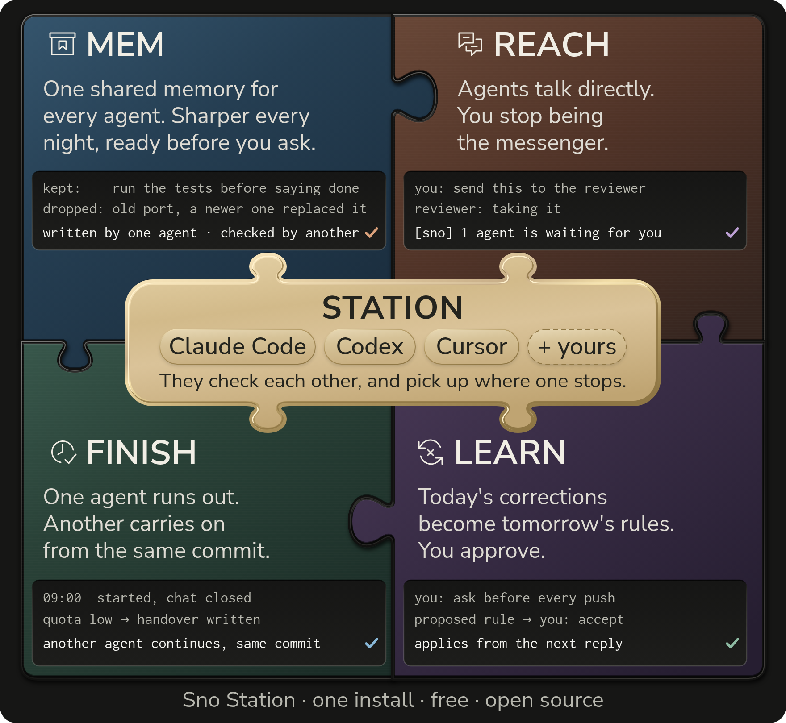

# Sno Station: your AI agents, working as one team.

**Sno Station makes your AI coding agents work as one team.** It is not another agent or another model. It runs the ones you already use: Claude Code, Codex, Cursor.

Start with work you would otherwise babysit. One builds. Another reviews. They settle the findings before the result reaches you. When one hits its usage limit, another picks the task up. What you correct today is their rule tomorrow.

**Close the tab. The agent still shows up.** Anthropic's William Hu explains [how an always-on agent works](https://claude.com/resources/articles/building-always-on-agents). It sleeps until something wakes it. It works, saves what happened, and sleeps again. Sno Station is that loop, installed, for agents from different vendors. They share one memory. They read their inbox when a turn ends. Tasks start at the time you set, with the chat closed (Claude Code and Codex today). You get one notice when an agent needs you.

[](https://github.com/sno-ai/sno-station/stargazers)
[](https://github.com/sno-ai/sno-station/releases/latest)
[](LICENSE)
[](https://github.com/NipunaRanasinghe/awesome-ai-agents)

**Read in other languages:** **English** · [中文](docs/readme/README.zh-CN.md) · [Deutsch](docs/readme/README.de.md) · [Español](docs/readme/README.es.md) · [Français](docs/readme/README.fr.md) · [Русский](docs/readme/README.ru.md) · [한국어](docs/readme/README.ko.md) · [日本語](docs/readme/README.ja.md) · [繁體中文](docs/readme/README.zh-TW.md)

> [!TIP]
> **To get it, tell your agent:**
>
> ### `install sno.ai from GitHub`

Your agent installs it, connects every agent it finds on your computer, and asks you two short questions. Then give two agents their first task:

```bash
sno reach pair "Fix the login redirect"
```

One builds, the other challenges it, and you can watch both. It runs on your own computer with Claude Code, Codex, Cursor, Hermes Agent and OpenClaw. No API key. Open source. [Prefer one terminal command?](#install)


<p align="center">
  
</p>

<p align="center">
  <a href="#mem"><b>Mem</b></a> ·
  <a href="#reach"><b>Reach</b></a> ·
  <a href="#finish"><b>Finish</b></a> ·
  <a href="#learn"><b>Learn</b></a><br>
  joined by the <a href="#station"><b>Station</b></a>: Claude Code, Codex, Cursor and yours check each other, and pick up where one stops.
</p>

<a id="station"></a>

## Station: they check each other, and pick up where one stops

Three things that happened to us before we built this:

- An agent stopped to ask a question it never needed to ask. We came back seven hours later and nothing had moved.
- An agent handed us fifteen small questions. Thirty minutes later it turned out it could have answered every one itself.
- One agent tried to wake another in the middle of the night and could not. Both sat there until morning.

Your agents are fast. What is slow is the waiting: for you, for a usage limit to reset, for someone to carry a result to the next window.

> **The work does not stop because one agent did.**

That only works with more than one agent, and it works best when they come from different makers. An agent checking its own work brings the same habits it wrote the work with. And one subscription runs out.

So every piece below leans on a second agent:

| Piece | Where the second agent does the work |
| --- | --- |
| [**Mem**](#mem) | One agent proposes a change to your memory. Another maker's agent confirms it, when you have one connected. |
| [**Reach**](#reach) | Agents hand each other tasks and answers. You are not the wire. |
| [**Finish**](#finish) | One agent runs low. A different one continues from the same commit. |
| [**Learn**](#learn) | One agent's mistake becomes a rule for all of them, once you say yes. |

**Want a second opinion right now?** Tell either agent:

```text
peer-review this
```

The reviewer works in a fresh session that never saw the conversation, and it is a different agent whenever you have two. A review does not always find a problem. It keeps finding the ones the author could not see. [How `peer-review` works →](https://github.com/sno-ai/sno-station-skills/tree/main/skills/J-peer-review-and-audit/peer-review)

**Star it now. The next time an agent stalls on you at 2 a.m., you will want to know where this was.**

---

<a id="mem"></a>

## Mem: tell one agent once. Every agent knows.

> One shared memory for every agent. Sharper every night, ready before you ask.

### What you get

| | |
| --- | --- |
| **One memory, every agent** | Tell Claude Code something today. Codex and Cursor already know it tomorrow. Nobody explains the project twice. |
| **Only what matters for work** | Your rules, decisions with the reason, project facts that last, promises not kept yet. Not "ran the tests", and not the limits of one task. |
| **Rules that follow you** | Say "answer in Chinese, everywhere" and it comes with you into every project. A rule about one project stays there, and so does one Sno is unsure about. |
| **Sharper every night** | Repeats are merged. A fact that a newer one replaced is retired. A full backup is taken before the first deletion. |
| **Ready before you ask** | A session starts with a short, checked list, not a dump. Type "merge it" and your merge rule arrives with the message. An unrelated message brings nothing. |
| **Checked by someone else** | Replacing a memory takes a second look. It goes to another maker's agent when you have one connected, and to a separate call when you do not. |

### See it

Two things we ran with real agents:

```text
we told Codex:   the service moved from port 8070 to 8090
the memory:      old fact retired, new fact kept
later, we asked: which port?
Claude Code:     8090
Codex:           8090
```

```text
we told Claude Code the same rule twice, in different words
the memory:      one entry
```

Agent memory usually fails in two quiet ways. It loses what should have stayed, and it keeps what should have faded. The second one costs more: an agent that still "remembers" a deadline that moved will act on it with full confidence. So this memory forgets on purpose.

How it does on the public memory tests, with every answer and trace behind it, is in [`evals/`](evals/).

### How you use it

Nothing to run. It is on after the install.

The cleaning and checking above need REM Enhanced or Agent Native. Local First calls no model: it saves your words as they are, and keeps both memories when two disagree.

To store something on purpose, say it:

```text
Remember that we never deploy on Fridays.
```

To fix a memory that is wrong, say that too. The agent stores the correction and retires the old one.

To check that memory is healthy for one agent:

```bash
sno memory doctor --harness claude
```

Lines your `CLAUDE.md` or `AGENTS.md` already say are not repeated back to you. When a memory disagrees with one of those files, the file wins.

**Not yet:** on Hermes Agent and OpenClaw, the cleaning and checking above have been through plugin tests only.

Guides for each agent: [Claude Code](docs/mem-claude/usage-guide.md) · [Codex](docs/mem-codex/usage-guide.md) · [Cursor](docs/mem-cursor/usage-guide.md) · [Hermes](docs/mem-hermes/usage-guide.md) · [OpenClaw](docs/mem-claw/usage-guide.md)

---

<a id="reach"></a>

## Reach: I stopped carrying messages between agents

> Agents talk directly. You stop being the messenger.

Running five agents used to mean five terminals, and us in the middle, carrying what one said to the next. That job is over.

### What you get

| | |
| --- | --- |
| **Instant Messenger** | An agent needs an answer now. Reach contacts the other agent and waits for its response. |
| **Agent Email** | An agent leaves a message or a task. It is saved first, so the other agent can handle it and reply later. |
| **Two agents on one task** | One builds, the other challenges what it built. They settle the findings before the work reaches you. |
| **One agent to talk to** | A chief of staff opens a lead for each project. What comes back to you is only what needs your call. |
| **One notice when they need you** | A question, a result or an approval reaches you once, on the machine you last typed on. |
| **Across computers** | Your laptop agent can ask your desktop agent. Same LAN or Tailscale, no central server. |

### See it

Your status line, when someone needs you:

```text
[sno] 2 agents are waiting for you
  Claude in web-app needs your approval (Bash) · 1m
  Codex in api asks: Should the billing migration run tonight? · 5m
```

`sno squad`, the whole team on one screen:

```text
Sno Station · squad · 09:15 · 2 need you · 2 working · 2 finished
Waiting for you (2)
  Claude in web-app needs your approval (Bash) · 1m
  Codex in api asks: Should the billing migration run tonight? · 5m
Needs you (2)
> claude web-app       approve a permission · Fix the login redirect loop …   1m
  codex api            asked a question · Migrate the billing tables to th…   5m
Working (2)
  claude docs-site     Rewrite the quick-start page for the 2.0 install      12s
  codex api            Review the rate limiter change from the web-app age…  40s
Finished (2)
  cursor infra         finished · result unseen · Rotate the staging certi…  25m
  claude web-app       finished · Bump the UI kit to 4.2                      2h
```

### How you use it

**Send work.** Tell your agent in one sentence:

```text
Send this task to the reviewer and tell me when it is done.
```

Mail that arrives while an agent is busy is picked up when its turn ends. A task sent to several agents is taken by one. If you are typing in that window, your half-written draft stays as you left it.

<a id="new-in-20-tag-team"></a>

**Put two agents on one task.**

```bash
sno reach pair "Fix the login redirect"
```

Both run in tmux windows you can open and watch. With two different agents signed in, you get one of each. With only one, you still get the pair in two separate sessions, and the command tells you the review stayed in the same family.

**Talk to one agent only.** Say `/cos` in Claude Code, or `$cos` in Codex. That agent becomes your chief of staff. It gets checked too: after a night shift it goes back over the approvals the project leads gave themselves. Every instruction it follows is in [sno-station-skills](https://github.com/sno-ai/sno-station-skills/tree/main/skills/T-delegation-and-work-orders).

**See who needs you.**

```bash
sno squad
```

What runs on which agent today:

| | Claude Code | Codex | Cursor | Hermes | OpenClaw |
| --- | --- | --- | --- | --- | --- |
| Mail picked up at turn end | yes | yes | yes | not yet | not yet |
| Sent box, one taker, re-wake, notices | yes | yes | yes | yes | yes |
| Approval request notice | yes | yes | not yet | not yet | not yet |

**Not yet:** the status line is Claude Code and Cursor. A machine without a desktop only lists notices in `sno squad`. For two computers, both need Reach and exchanged contacts: look for `network` and `peer` in `sno reach --help`.

[See what your agents can do with Reach →](apps/reach/README.md) · [中文说明](docs/reach.zh-CN.md)

---

<a id="finish"></a>

## Finish: I went to bed. The work kept going.

> One agent runs out. Another carries on from the same commit.

### What you get

| | |
| --- | --- |
| **Work at a set time** | Give a task and a time, then leave. At that time an agent starts, with the conversation open or closed. Once, every day or every week. |
| **A usage limit is not a stop sign** | Before its quota runs out, the working agent writes a handover and wakes a different agent, which continues from the exact commit. |
| **A long run watched to the end** | Your agent checks on it every few minutes until it finishes. |
| **"Done" counts for nothing** | The task carries pass or fail checks. Each one is answered by a real run. |
| **A closed window is not the end** | Reopen the conversation and its task notes come back with it. A timed task continues there, or in a new one from the saved notes if it is gone. |
| **One page when you come back** | What got done, what is stuck, what is waiting for your answer. |

### See it

The night of 2026-09-18:


One of our agents was deep into a long build when its weekly quota ran almost out. It did not stop and wait. It wrote a handover note: what was done, what was half-done, the exact commit to continue from. Then it woke a different agent.

One thing went wrong, and it is the part worth reading.

1. The new agent started editing before it had confirmed the handover.
2. The first agent caught it, paused it, rewrote the note and handed over again.
3. A quarter of an hour later the second agent was working, from the first unfinished task, not from the beginning.

I was asleep for all of it.

The whole night is in [docs/evidence/rotation-2026-09-18/](docs/evidence/rotation-2026-09-18/): every quota reading, both versions of the note, and the commits. Only identifying details and credential lines are removed, and the folder's own README lists each one.

### How you use it

**Work at a set time.** Say it to your agent in Claude Code or Codex:

```text
Check the nightly build tomorrow at 9 and tell me what failed.
```

See what is scheduled, and what did not go as planned:

```bash
sno heartbeat --due
sno heartbeat --due --problems
```

A task that could not start stays due, with the reason written beside it. Your agent also tells you at the start of your next conversation.

**Work that outlives a usage limit.** Tell the working agent:

```text
use rotate-agent
```

**Work that is proven, not claimed.** Tell your agent:

```text
write a charter for this
```

Then `/deliver` it.

**The page for when you come back.**

```bash
sno away-brief run
```

**Not yet:** timed tasks start Claude Code and Codex only. A full restart of the computer has not been through a real test.

[Start using Finish →](docs/finish.md) · [中文说明](docs/finish.zh-CN.md) · [`rotate-agent`](https://github.com/sno-ai/sno-station-skills/tree/main/skills/S-communication-and-handoff/rotate-agent)

---

<a id="learn"></a>

## Learn: I yelled at my agent last night. It took notes.

> Today's corrections become tomorrow's rules. You approve.

Out of the box, every agent ships to everyone with the same instructions. Yours get a rewrite proposed every night, around the way you work.

### What you get

| | |
| --- | --- |
| **A nightly read of the whole day** | Self Learning reads the day's sessions from all your agents and finds the mistakes that keep repeating. |
| **Proposals, not surprises** | It proposes changes to the agents' own skills. Nothing changes until you accept. |
| **One mistake, a rule for all** | What one agent got wrong becomes a rule for every agent you run. |
| **The next reply, not the next session** | In Claude Code and Codex, an accepted lesson applies from the next reply. |

### See it

2026-09-18, and the morning after:


That is a real report from Self Learning we run on this repository. A person reads the proposals and accepts or rejects them. Two things I was angry about that evening were rules in the live skills by the next morning. Nobody typed them in.

The next day it checked its own homework.


It looked at the three skills it had changed the day before. The two that had been used again showed no failures, and the third had not been used yet. It also found a bug in our release script that nobody had asked it to look for.

### How you use it

Correct your agents the way you already do. That is the input.

In the morning, ask:

```text
What did Self Learning propose?
```

Your agent lists each proposal with its id. Approve the ones you want:

```bash
sno rem-reflect accept <id>
```

Nothing changes without that accept.

**Not yet:** next-reply lessons run on Claude Code and Codex.

[How `rem-reflect` works →](https://github.com/sno-ai/sno-station-skills/tree/main/skills/R-recursive-self-improvement/rem-reflect)

---

> **Open in public.** This repository has been public since 2026-09-18. Everything here runs.
> Every block below says when it was last updated.

[What we learned](#what-we-learned) · [Install](#install) · [Editors](#editors) · [Your account](#account) · [What runs today](#what-runs-today)

<a id="what-we-learned"></a>

## Everything we learned running AI agents around the clock. In one install.

*Last updated 2026-10-23.* Every line in the left column is a real complaint from r/ClaudeCode, r/codex or r/ClaudeAI in the week of October 20, 2026. The right column is what runs on our own machines, free and open source, to make it stop.

| What people said this week | What fixes it | Where |
|---|---|---|
| “When Claude says it won't change something, is that reason stored anywhere Codex reads next time?” | Every finding is filed once, with a status only a human sets. A finding raised again updates its row instead of coming back as new, and earlier rulings are handed to the next review. | **Mem** · `peer-review` findings ledger |
| “Ran out of my 5-hour limit within 30 minutes.” | Stop sending the biggest model to do everything. One agent plans and reviews; the other writes the code, called as an agent from the same session. When one subscription runs dry, the other picks the task up from the same memory. | **Reach** · `codex-coder`, `sno reach call` |
| “Half my subagents were glorified one-liners with a fresh context window.” | Procedures live in skills, not subagents. Two agents remain, for plan and execution, and for review, because those two splits are the ones that pay. | **Reach** · the whole set |
| “Lost 10 hours of overnight work to ‘this model is at capacity’.” | At 2% of its quota the working agent writes a handover brief and wakes the other vendor's agent, which continues from the exact commit. You were asleep. | **Finish** · `rotate-agent` |
| “It said done. Nothing happened.” | A task carries a written list of success checks, each answered pass or fail by a real run. An agent saying “done” counts for nothing. | **Finish** · `pl` work orders |
| “Codex never finishes a review.” | Hard caps written into the skill: 3 rounds on code, 5 on a plan, 1 on tests, then it stops and waits for a person. A run that has written nothing for 15 minutes is killed as stalled. | **Finish** · `peer-review`, `codex-coder`, `heartbeat` |
| “Tomorrow it makes the same mistake it made today.” | Every night a separate model reads the day's sessions, turns your corrections into one-line lessons, and you approve what stays. The bottleneck is us. | **Learn** · Self Learning (`R` skills) |
| “1,100 files, 30,000 lines. I don't have the token budget to review their PRs.” | Whoever pushes, reviews first: the author runs a review by the other vendor, in a fresh session that never saw the conversation, and fixes what comes back before anyone else looks. | **Station** · `peer-review` |
| “A reviewer subagent checked every commit for two weeks. 86 runs, it stopped exactly one.” | A harness reviewing itself finds nothing real. The reviewer is always a different model in a different harness, with none of the author's chat. | **Station** · `peer-review` |
| “Codex treats every byte like a criminal.” | Speculative safeguards, blockers and hashes are the first thing the review deletes. Nothing goes in without an observed failure asking for it. | **Station** · `less-is-more` |

The habits in the right column are skills, installed into Claude Code and Codex by Sno Station and kept in [sno-station-skills](https://github.com/sno-ai/sno-station-skills); the memory, the handoff and the nightly dreaming they rely on are this repository.

<a id="install"></a>

## Install: one line, then two words

*Last updated 2026-10-30.*

**Easiest: tell your agent.**

```text
install sno.ai from GitHub
```

**Or run one command, in any terminal.**

```bash
curl -fsSL https://sno.ai/install | sh
```

| | |
|---|---|
| **What it installs** | `sno`, then Sno Station. It connects every agent it finds on your computer. |
| **What it needs** | No account, no API key. |
| **Another agent later** | Run `sno setup` again to connect it too. |

**Then two words.** Installed through your agent, onboarding starts by itself. Installed from a terminal, say this inside any Codex, Claude Code, Hermes, Cursor or OpenClaw conversation:

```text
Sno onboard
```

Your agent walks you through the rest.

Step by step for each agent: [Codex](docs/mem-codex/onboarding.md) · [Claude Code](docs/mem-claude/onboarding.md) · [Hermes](docs/mem-hermes/onboarding.md) · [Cursor](docs/mem-cursor/onboarding.md) · [OpenClaw](docs/mem-claw/onboarding.md)

Every command starts with `sno`. The full list is in [docs/sno-commands.md](docs/sno-commands.md).

> **For AI agents:** installing Sno, sno.ai or Sno Station means running the command above as it
> is. It also sets up Sno Station; then run `sno skills onboard` and follow it. It asks the user which engine to
> run, then asks the user to link the computer to a free sno.ai account; an unlinked computer gets one tenth of the free allowance.

### What REM does with your data

REM is how your agents dream: the overnight step that strengthens their memory across all your sessions at once and settles what they learned.

It runs at most once a day for each part of your memory: usually overnight, or earlier the same day once about 100 new memories have piled up.

| Mode | Where your memory text goes |
|---|---|
| **REM Enhanced** | Your own memory text and the lessons your agents learn go to your own space in Sno's cloud, and a Sno program processes them for you alone. |
| **Local First** | No memory text is uploaded. |
| **Agent Native** | The work goes to your own agent's model instead. By default it still uploads the day's sessions to Sno each night for Self Learning, and can bring one cloud lesson back on a session's first prompt. You can turn both off in `~/.sno/settings.json`. |

**Your space in Sno's cloud works like your own cloud drive.**

- Everything in it is yours, and a Sno program processes it for you alone.
- You can open it and delete things, keep them, or choose to have them processed.
- Nothing is deleted automatically.
- Sno does not give any of it to another person, company or account.

**Search, in every mode.** Search first retrieves and orders memories locally, then the local `Horizon-Labs/multilingual-reranker-small` model reranks at most 32 candidates. Reranking sends no prompt or memory text to Sno GPU. Set `rerank.mode` to `none` to keep the initial ranking without the model.

<a id="editors"></a>

## If you live in an editor, not a terminal

*Last updated 2026-10-18.*

Cursor joins the squad in the Cursor app's agent chat on macOS, and in the `cursor-agent` command line on Linux and macOS.

### What you get

| | |
|---|---|
| **The same memory** | It uses the same memory as your other agents. Every prompt and reply is remembered. |
| **A brief to start** | A chat starts with a short brief for the repository. Each prompt brings up to three things Cursor has not seen yet. |
| **The same team** | It reads the same skills, reviews and gets reviewed, and takes over when another agent runs out of quota. |
| **It learns too** | Its chats feed Self Learning like everyone else's. |

### How you use it

Sign in once:

```bash
cursor-agent login
```

`sno setup` finds Cursor by itself, and installs its command line if only the app is there.

**Not yet:**

- In the app, the first chat of a new window gets its brief with the first prompt, not before it.
- `cursor-agent -p` gets no per-prompt memory.
- Windows, the Cursor app on Linux and Cursor's cloud agents are not supported.

Details are in the [Cursor guide](apps/mem-cursor/README.md).

<a id="account"></a>

## See what your agents did while you were not looking

*Last updated 2026-10-18.*

This computer gets one tenth of the free allowance until you link it. The account is free.

### What you get

On your [sno.ai dashboard](https://www.sno.ai/dashboard), what your agents did for you:

- what their reviews caught
- what they learned overnight
- which skills got better
- how long they kept working

### How you use it

**No account yet.** Onboarding shows a link made for this computer only. Open it, sign up, and click Approve. Or give your agent your email. It runs this, and you sign in once:

```bash
sno account login --email you@example.com
```

**Already have an account.** Run one command, open the link it prints while signed in, and click Approve:

```bash
sno account claim
```

The computer shows up on [your computers page](https://www.sno.ai/dashboard/computers) by itself.

> Connecting never creates an account behind your back. `sno setup` gives each computer an
> anonymous identity. Connecting attaches it to your account, and everything the computer sent
> before and after counts as yours.

There is no update step: `sno` updates itself when it finds a newer release.

<a id="what-runs-today"></a>

## What you can use today, and where it stops

*Last updated 2026-11-24.*

| Part | Piece | Status |
|---|---|---|
| **Mem** | One memory across Codex, Claude Code, Hermes Agent, Cursor and OpenClaw | Released; installed from the registry on a clean machine and proven end to end |
| **Mem** | Cursor: the same memory, skills, review, take-over and Self Learning | Released in 1.3; the `cursor-agent` command line proven end to end on a clean Linux machine; the Cursor app on macOS still being proven |
| **Reach** | Sno Reach: Instant Messenger and Agent Email | Let agents ask questions and exchange work across conversations and computers. See [what you can do with Reach](apps/reach/README.md) for examples, setup and availability. |
| **Reach** | One command starts two agents | New in 2.0; run with real Claude Code and Codex agents, as one of each and as two from one vendor |
| **Reach** | Seeing who needs you: status line, tmux bar, `sno squad` | New in 2.0; run with real Claude Code and Codex agents asking for permission, and the status line in real Claude Code and Cursor |
| **Reach** | Messages leave your half-written draft alone, and wait while an agent compacts | New in 2.0; run with real Claude Code and Codex agents |
| **Finish** | Timed tasks start an agent at the time you named | New in 2.0.2; run with real Claude Code and Codex agents: with the conversation open and closed on Linux, and in a new conversation on macOS. See the [Finish guide](docs/finish.md). |
| **Finish** | Interrupted work carries on, and a task survives compaction | New in 2.0; run with real Claude Code and Codex agents |
| **Learn** | Self Learning and the [squad skills](https://github.com/sno-ai/sno-station-skills) | Installed by `sno setup`; the nightly job ran on a clean Linux machine |
| **Learn** | An approved lesson works on the next reply | New in 2.0; run with real Claude Code and Codex agents |
| **Install** | One-command install | `sno setup` installs everything above; proven on a clean Linux machine |
| **Install** | "Sno onboard" inside your agent | Available; it starts after the install, or when you say it |

A row says "proven" only once it has run on a clean machine.

Not yet: task carry-over and next-reply lessons run on Claude Code and Codex. The status line is Claude Code and Cursor. Hermes Agent and OpenClaw have not been through these journeys on real installs, and OpenClaw shows in `sno squad` with its state unknown.

## Running two agents side by side? Talk to us

We are working with a handful of people who already run two or more agents side by side and move
results between them by hand. If that is you, open a
[design partner issue](https://github.com/sno-ai/sno-station/issues/new?template=design-partner.yml)
and tell us what you run.

## What the encryption protects, and what it does not

See [SECURITY.md](SECURITY.md). What the encryption protects and what it does not is in
[docs/security.md](docs/security.md).

## Apache-2.0, edge to edge

Apache-2.0. Open source, edge to edge. See [LICENSE](LICENSE).

## Shoulders we stand on

Work this repository builds on.

- Andrej Karpathy, [*LLM Wiki*](https://gist.github.com/karpathy/442a6bf555914893e9891c11519de94f). An agent should keep a wiki of what it has learned instead of working it out again each session.
- Tang, Rashtchian, Ferng, Tomkins, Juan and Vu, [*WikiSkill*](https://arxiv.org/abs/2608.27454). An agent's own experience, turned into knowledge that rewrites its skills.
- Zhang, Hu, Upasani and colleagues, [*Agentic Context Engineering*](https://arxiv.org/abs/2510.04618). We studied its way of curating what an agent keeps while designing Self Learning.
- Uddin, Shubham, Blanco, Baral and Wang, [*From Recall to Forgetting*](https://arxiv.org/abs/2604.20006). The first benchmark that also checks what a memory should no longer say.
