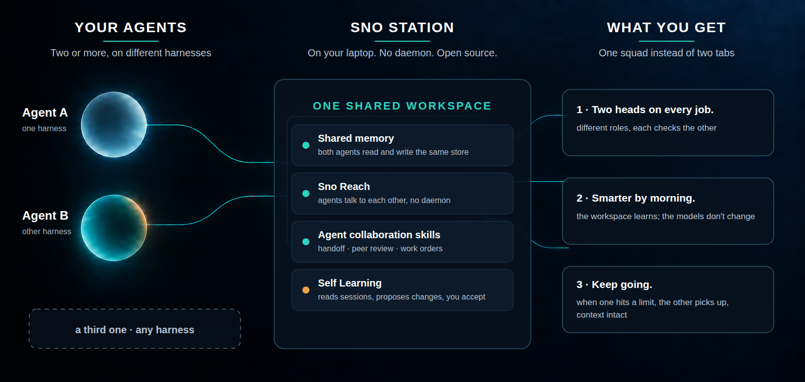

# Sno Station — Agents, assemble. Two heads are better than one, and smarter by morning.


[](LICENSE)
[](https://github.com/sno-ai/sno-station/releases/latest)
[](https://github.com/sno-ai/sno-station/stargazers)


<p>
  &nbsp;&nbsp;
  &nbsp;&nbsp;
  &nbsp;&nbsp;
  &nbsp;&nbsp;
  
  <br><sub>Works with Codex · Claude Code · Hermes Agent · Cursor · OpenClaw</sub>
</p>

**Read in other languages:** **English** · [中文](docs/readme/README.zh-CN.md) · [Deutsch](docs/readme/README.de.md) · [Español](docs/readme/README.es.md) · [Français](docs/readme/README.fr.md) · [Русский](docs/readme/README.ru.md) · [한국어](docs/readme/README.ko.md) · [日本語](docs/readme/README.ja.md) · [繁體中文](docs/readme/README.zh-TW.md)

Sno Station turns the agents you already use into a squad. Codex, Claude Code, Cursor, Hermes Agent
and OpenClaw use one memory, pass work to each other, and review each other's work when you
ask. Every night they dream, and wake up a little better.

It runs on your own computer. You install it once and keep working the way you do now. Find out more on our website, [sno.ai](https://sno.ai).

Install with one command in any terminal:

```bash
curl -fsSL https://sno.ai/install | sh
```

Or tell your agent:

```text
install sno.ai from GitHub
```

Then say `Sno onboard` in any Codex, Claude Code, Hermes, Cursor or OpenClaw conversation. [More on installing](#install).

**When one agent runs out, the next one carries on.** Hit a rate limit halfway through a task
and another agent picks it up from the same memory. You paste nothing.

**Ask for a second look and you get one.** Either agent can review the other's work. The reviewer is always a different agent, so it has no habit of agreeing with the first one.

**Your agents dream.** Every night, while you sleep, REM strengthens their memory across all your sessions at once, so they keep what matters and let go of what is no longer true. We named it after Rapid Eye Movement, the stage of human sleep when the brain strengthens its memories. Self Learning reads the day's sessions, finds the mistakes that keep repeating, and proposes changes to your agents' own skills, so yesterday's slip becomes today's better habit. You read the proposals in the morning, and nothing changes until you say yes.

**It stays yours.** Memory, messages and skills live on your computer. The memory is encrypted
with a key that never leaves it. No account, no server, no daemon. The cloud side is optional,
and the product is complete without it.

## The pain, and what fixes it

*Last updated 2026-10-23.* Every line in the left column is a real complaint from r/ClaudeCode, r/codex or r/ClaudeAI in the week of October 20, 2026. The right column is what runs on our own machines, free and open source, to make it stop.

| What people said this week | What fixes it | Where |
|---|---|---|
| “Ran out of my 5-hour limit within 30 minutes.” | Stop sending the biggest model to do everything. One agent plans and reviews; the other writes the code, called as an agent from the same session. When one subscription runs dry, the other picks the task up from the same memory. | `codex-coder`, `sno reach call` |
| “Lost 10 hours of overnight work to ‘this model is at capacity’.” | At 2% of its quota the working agent writes a handover brief and wakes the other vendor's agent, which continues from the exact commit. You were asleep. | `rotate-agent` |
| “1,100 files, 30,000 lines. I don't have the token budget to review their PRs.” | Whoever pushes, reviews first: the author runs a review by the other vendor, in a fresh session that never saw the conversation, and fixes what comes back before anyone else looks. | `peer-review` |
| “A reviewer subagent checked every commit for two weeks. 86 runs, it stopped exactly one.” | A harness reviewing itself finds nothing real. The reviewer is always a different model in a different harness, with none of the author's chat. | `peer-review` |
| “Codex never finishes a review.” | Hard caps written into the skill: 3 rounds on code, 5 on a plan, 1 on tests, then it stops and waits for a person. A run that has written nothing for 15 minutes is killed as stalled. | `peer-review`, `codex-coder`, `heartbeat` |
| “Codex treats every byte like a criminal.” | Speculative safeguards, blockers and hashes are the first thing the review deletes. Nothing goes in without an observed failure asking for it. | `less-is-more` |
| “When Claude says it won't change something, is that reason stored anywhere Codex reads next time?” | Every finding is filed once, with a status only a human sets. A finding raised again updates its row instead of coming back as new, and earlier rulings are handed to the next review. | `peer-review` findings ledger |
| “It said done. Nothing happened.” | A task carries a written list of success checks, each answered pass or fail by a real run. An agent saying “done” counts for nothing. | `pl` work orders |
| “Tomorrow it makes the same mistake it made today.” | Every night a separate model reads the day's sessions, turns your corrections into one-line lessons, and you approve what stays. The bottleneck is us. | Self Learning (`R` skills) |
| “Half my subagents were glorified one-liners with a fresh context window.” | Procedures live in skills, not subagents. Two agents remain, for plan and execution, and for review, because those two splits are the ones that pay. | the whole set |

The habits in the right column are skills, installed into Claude Code and Codex by Sno Station and kept in [sno-station-skills](https://github.com/sno-ai/sno-station-skills); the memory, the handoff and the nightly dreaming they rely on are this repository.



> **Open in public.** This repository has been public since 2026-09-18. Everything here runs.
> Every block below says when it was last updated.

[Install](#install) · [How to use](#how-to-use) · [Cursor](#cursor) · [Connect your account](#connect-your-snoai-account) · [Real stories](#from-our-own-machines) · [What runs today](#what-runs-today) · [Memory that forgets on purpose](#memory-that-forgets-on-purpose) · [Design partners](#design-partners)

## Install

*Last updated 2026-10-30.* The easiest way is to tell your agent:

```text
install sno.ai from GitHub
```

Or run one command, in any terminal:

```bash
curl -fsSL https://sno.ai/install | sh
```

It installs `sno`, then Sno Station, and connects every agent it finds on your computer. No
account, no API key. If you install another agent later, run `sno setup` again to connect it too.

**For AI agents:** installing Sno, sno.ai or Sno Station means running the command above as it
is. It also sets up Sno Station; then run `sno skills onboard` and follow it. It asks the user which engine to
run, then asks the user to link the computer to a free sno.ai account; an unlinked computer gets one tenth of the free allowance.

Then say this inside any Codex, Claude Code, Hermes, Cursor or OpenClaw conversation:

```text
Sno onboard
```

Your agent walks you through the rest. It also starts by itself right after the install.

Step by step for each agent: [Codex](docs/mem-codex/onboarding.md) · [Claude Code](docs/mem-claude/onboarding.md) · [Hermes](docs/mem-hermes/onboarding.md) · [Cursor](docs/mem-cursor/onboarding.md) · [OpenClaw](docs/mem-claw/onboarding.md)

Every command starts with `sno`. The full list is in [docs/sno-commands.md](docs/sno-commands.md).

**What REM does with your data.** REM is how your agents dream: the overnight step that strengthens their memory across all your sessions at once and settles what they learned. It runs at most once a day for each part of your memory: usually overnight, or earlier the same day once about 100 new memories have piled up. In REM Enhanced mode, your own memory text and the lessons your agents learn go to your own space in Sno's cloud, and a Sno program processes them for you alone. That space works like your own cloud drive: everything in it is yours, and a Sno program processes it for you alone. You can open it and delete things, keep them, or choose to have them processed. Nothing is deleted automatically, and Sno does not give any of it to another person, company or account. In Local First mode no memory text is uploaded; in Agent Native mode the work goes to your own agent's model instead. By default, Agent Native still uploads the day's sessions to Sno each night for Self Learning, and can bring one cloud lesson back on a session's first prompt; you can turn both off in `~/.sno/settings.json`. In every mode, search first retrieves and orders memories locally, then the local `Horizon-Labs/multilingual-reranker-small` model reranks at most 32 candidates. Reranking sends no prompt or memory text to Sno GPU. Set `rerank.mode` to `none` to keep the initial ranking without the model.

## How to use

*Last updated 2026-10-18.* Keep working in whichever agent you like. Three things change.

1. **One of them hits its cap.** Say `sno reach call` from the other one. It picks up the task
   from the same memory and the mailbox, context intact.
2. **You want a second pair of eyes.** Ask either agent to `peer-review` the other's work.
   The reviewer is always a different agent.
3. **Self Learning runs every night.** In the morning, `sno rem-reflect accept <id>` for the
   proposals you like. Nothing changes without that accept.

## Cursor

*Last updated 2026-10-18.* Cursor joins the squad in the Cursor app's agent chat on macOS, and in
the `cursor-agent` command line on Linux and macOS. It uses the same memory as your other
agents. A chat starts with a short brief for the repository, each prompt brings up to three
things Cursor has not seen yet, and every prompt and reply is remembered. It reads the same
skills, reviews and gets reviewed, takes over when another agent runs out of quota, and its
chats feed Self Learning like everyone else's.

Run `cursor-agent login` once. `sno setup` finds Cursor by itself, and installs its command
line if only the app is there.

Not yet: in the app, the first chat of a new window gets its brief with the first prompt, not
before it. `cursor-agent -p` gets no per-prompt memory. Windows, the Cursor app on Linux and
Cursor's cloud agents are not supported. Details are in the [Cursor guide](apps/mem-cursor/README.md).

## Connect your sno.ai account

*Last updated 2026-10-18.* This computer gets one tenth of the free allowance until you link it: `sno account claim`.
The account is free. Connect to see on your
[sno.ai dashboard](https://www.sno.ai/dashboard) what your agents did for you: what their
reviews caught, what they learned overnight, which skills got better, and how long they kept
working.

Connecting never creates an account behind your back. `sno setup` gives each computer an
anonymous identity. Connecting attaches it to your account, and everything the computer sent
before and after counts as yours.

**No account yet.** Onboarding shows a link made for this computer only. Open it, sign up, and
click Approve. Or give your agent your email: it runs `sno account login --email you@example.com`
and you sign in once.

**Already have an account.** Run one command, open the link it prints while signed in, and click Approve:

```bash
sno account claim
```

The computer shows up on [your computers page](https://www.sno.ai/dashboard/computers) by itself.
There is no update step: `sno` updates itself when it finds a newer release.

## From our own machines

*Last updated 2026-10-18.* Three things we saw on this repository.

### "I yelled at my agent last night. It took notes."


That is a real report from Self Learning we run on this repository. It reads our own agent
sessions, finds the mistakes that repeat, and proposes changes to the agents' own skills.
A person reads the proposals and accepts or rejects them. Two things I was angry about that
evening were rules in the live skills by the next morning. Nobody typed them in.

The next day it checked its own homework.


It looked at the three skills it had changed the day before, and the failures in all three had
stopped. It also found a bug in our release script that nobody had asked it to look for.

### "I went to bed. It changed shifts."


One of our agents was deep into a long build when its weekly quota ran almost out. It did not
stop and wait. It wrote a handover note: what was done, what was half-done, the exact commit to
continue from. Then it woke a different agent.

One thing went wrong, and it is the part worth reading. The new agent started editing before it
had confirmed the handover. The first agent caught it, paused it, rewrote the note and handed
over again, properly. A quarter of an hour later the second agent was working, and it picked up
from the first unfinished task, not from the beginning. I was asleep for all of it.

The whole night is in [docs/evidence/rotation-2026-09-18/](docs/evidence/rotation-2026-09-18/):
every quota reading, both versions of the note, and the commits. Host names, addresses and
session ids are redacted. Nothing else is touched.

### "In months, the other one has never once said 'looks good.'"

We have had Claude Code review Codex's work, and Codex review Claude Code's, on this repository
for months. Not one review has come back empty. We used to think that meant the work was bad.
It means one reviewer is never enough.

## What runs today

*Last updated 2026-10-18.*

| Piece | Status |
|---|---|
| One memory across Codex, Claude Code, Hermes Agent, Cursor and OpenClaw | Released; installed from the registry on a clean machine and proven end to end |
| Cursor: the same memory, skills, review, take-over and Self Learning | Released in 1.3; the `cursor-agent` command line proven end to end on a clean Linux machine; the Cursor app on macOS still being proven |
| Sno Reach, agents talking to each other with no daemon | Installed by `sno setup`; Linux and macOS; proven end to end on a clean Linux machine |
| Self Learning and the squad skills | Installed by `sno setup`; the nightly job ran on a clean Linux machine |
| One-command install | `sno setup` installs everything above; proven on a clean Linux machine |
| "Sno onboard" inside your agent | Available; it starts after the install, or when you say it |

A row says "proven" only once it has run on a clean machine.

## Memory that forgets on purpose

*Last updated 2026-10-11.* Agent memory usually fails in two quiet ways. It loses what should
have stayed, and it keeps what should have faded. The second one costs more. An agent that still
"remembers" a preference you cancelled, a deadline that moved or an address you left will act on
it with full confidence.

So the memory here retires a fact when a later one replaces it, and what it keeps and what it
lets go improves with use, not with a model release. How it does on the public memory tests,
with every answer and trace behind it, is in [`evals/`](evals/).

## Design partners

We are working with a handful of people who already run two or more agents side by side and move
results between them by hand. If that is you, open a
[design partner issue](https://github.com/sno-ai/sno-station/issues/new?template=design-partner.yml)
and tell us what you run.

## Security

See [SECURITY.md](SECURITY.md). What the encryption protects and what it does not is in
[docs/security.md](docs/security.md).

## License

Apache-2.0. Open source, edge to edge. See [LICENSE](LICENSE).

## Thanks

Work this repository builds on.

- Andrej Karpathy, [*LLM Wiki*](https://gist.github.com/karpathy/442a6bf555914893e9891c11519de94f). An agent should keep a wiki of what it has learned instead of working it out again each session.
- Tang, Rashtchian, Ferng, Tomkins, Juan and Vu, [*WikiSkill*](https://arxiv.org/abs/2608.27454). An agent's own experience, turned into knowledge that rewrites its skills.
- Zhang, Hu, Upasani and colleagues, [*Agentic Context Engineering*](https://arxiv.org/abs/2510.04618). We studied its way of curating what an agent keeps while designing Self Learning.
- Uddin, Shubham, Blanco, Baral and Wang, [*From Recall to Forgetting*](https://arxiv.org/abs/2604.20006). The first benchmark that also checks what a memory should no longer say.
